# PLENNA Suporte - MCP para consulta e gerenciamento de chamados

> Projeto acadêmico de Análise e Desenvolvimento de Sistemas (6º semestre). Implementação demonstrativa, com chamados fictícios e execução local.

## Por que este projeto existe?

Uma IA consegue explicar o que é um chamado de suporte, mas não tem como saber, sozinha, se o chamado 101 está aberto ou fechado neste momento. Se responder sem consultar a fonte de dados, corre o risco de apresentar uma informação convincente, porém incorreta.

Este projeto explora justamente essa diferença. Criamos um servidor **Model Context Protocol (MCP)** para disponibilizar um conjunto limitado de operações sobre chamados fictícios relacionados ao **PLENNA**, aplicativo voltado à reflexão sobre o consumo digital. O modelo de IA não lê diretamente o arquivo de dados: ele solicita uma ferramenta, o servidor executa a operação e devolve o resultado.

O objetivo não é construir uma central de atendimento pronta para produção, mas demonstrar **comunicação cliente-servidor, descoberta de capacidades, consulta fundamentada, validação, alteração controlada e rastreabilidade**.

## O que foi construído

A solução tem três partes distintas:

1. **Servidor MCP (`servidor.py`)**: publica uma Resource, quatro Tools e um Prompt usando `FastMCP`, da linha 1.x do SDK oficial de Python. Lê e atualiza exclusivamente `dados/chamados.json`.
2. **Clientes Python (`cliente.py` e `cliente_operacao.py`)**: exercitam diretamente o protocolo, sem depender de um modelo de linguagem. O primeiro cobre consultas e erros; o segundo pede confirmação antes de enviar uma operação de fechamento.
3. **Host de IA (LM Studio)**: executa localmente o modelo **Qwen3 4B Instruct 2507**, com quantização **GGUF Q4_K_M**, e conecta o servidor via MCP. O host apresenta o pedido de autorização para a chamada de ferramenta.

```text
Usuário
   │ pergunta em linguagem natural
   ▼
LM Studio (host) + Qwen3 (modelo)
   │ cliente MCP / stdio
   ▼
servidor.py (FastMCP)
   ├── Resource: plenna://politica
   ├── Tools: listar_chamados, consultar_chamado,
   │          filtrar_chamados, fechar_chamado
   └── Prompt: analisar_chamado
   │
   ├── dados/chamados.json   (leitura e escrita)
   └── operacoes.log        (registros de operações)
```

**Distinção importante:** o modelo decide qual ferramenta solicitar e redige a resposta; a ferramenta Python é quem consulta ou modifica os dados. Uma mensagem da IA, por si só, não equivale a uma operação executada.

## Estrutura do projeto

```text
MCP-Suporte/
├── servidor.py             # Recursos, ferramentas, prompt, validações e persistência
├── cliente.py              # Descoberta MCP, consultas, filtros e cenários inválidos
├── cliente_operacao.py     # Fechamento com confirmação explícita no terminal
├── requirements-lock.txt   # Versões instaladas das dependências
├── dados/
│   └── chamados.json       # Base fictícia; é alterada durante os testes de fechamento
├── operacoes.log           # Evidência de consultas, filtros e fechamentos executados
├── evidencias/             # Capturas reais dos testes com LM Studio
└── README.md
```

O arquivo `servidor.backup.py`, o ambiente `.venv` e as pastas `__pycache__` são auxiliares e **não precisam integrar a entrega**. Os relatórios acadêmicos estão organizados na pasta `docs/`.

## Preparação no Windows

**Requisitos:** Python compatível com o SDK MCP 1.x, PowerShell e acesso à internet para instalar dependências. O desenvolvimento e os testes deste projeto foram realizados em Windows, com Python 3.14.5 e SDK MCP 1.30.0. Para reproduzir exatamente as dependências do ambiente, utilize o `requirements-lock.txt` entregue.

Abra o PowerShell na pasta do projeto e execute:

```powershell
python -m venv .venv
.\.venv\Scripts\Activate.ps1
python -m pip install -r requirements-lock.txt
```

Se a política de execução do PowerShell impedir a ativação, é possível chamar o Python do ambiente diretamente, sem alterar políticas do sistema:

```powershell
.\.venv\Scripts\python.exe cliente.py
```

**Observação:** os comandos abaixo pressupõem que o ambiente virtual esteja ativado. O servidor usa **stdio**; portanto, não é necessário abrir uma porta HTTP nem iniciar `servidor.py` em uma janela separada. O cliente ou o host inicia esse processo automaticamente.

## Como executar e verificar

### Consultas e descoberta do protocolo

```powershell
python cliente.py
```

O cliente inicia uma sessão MCP, identifica as ferramentas disponíveis, lista Resources e Prompts, lê a política e obtém o Prompt de análise. Em seguida, testa chamadas válidas e inválidas. Entre os cenários efetivamente executados estão:

- Consulta do chamado **101**: retorna seus dados, incluindo o status persistido.
- Consulta do chamado **999**: retorna erro de chamado não encontrado.
- ID **-1**: rejeitado por não ser inteiro positivo.
- ID **`abc`**: rejeitado na validação de argumentos do MCP.
- Filtro de prioridade **`alta`**: retorna os chamados **101** e **104**.
- Prioridade **`urgente`**: rejeitada; são aceitas apenas `alta`, `media` e `baixa`.

### Fechamento com confirmação

```powershell
python cliente_operacao.py
```

O programa solicita o ID e pergunta se o usuário realmente deseja fechar o chamado. Se a resposta for negativa, **não envia a chamada de fechamento**. Com confirmação positiva, invoca `fechar_chamado`, atualiza o JSON e apresenta o retorno. A tentativa de fechar novamente um registro já fechado informa que o chamado estava fechado, sem necessidade de nova alteração.

No teste realizado em **13/10/2026**, o chamado **102** foi fechado com sucesso e a operação foi registrada no log.

**Atenção ao estado dos dados:** o JSON não é restaurado automaticamente após os testes. Na execução documentada, os chamados **101 e 102 estavam fechados**, enquanto **103 e 104 permaneciam abertos**. Esse estado pode mudar se novas operações de fechamento forem executadas.

### Conferir rastreabilidade

```powershell
Get-Content .\operacoes.log -Tail 15
```

Exemplos de eventos observados na execução de 13/10/2026:

```text
17:59:11 | consulta | ID=101 | sucesso
17:59:11 | consulta | ID=999 | nao encontrado
17:59:11 | filtro | prioridade=alta | total=2
18:00:03 | fechamento | ID=102 | sucesso
18:22:56 | consulta | ID=101 | sucesso
18:37:15 | consulta | ID=999 | nao encontrado
18:38:10 | filtro | prioridade=alta | total=2
```

*Trecho abreviado para leitura; o arquivo original inclui data, milissegundos e nível do log.*

## Contrato MCP exposto

| Tipo | Nome | Função e comportamento |
|---|---|---|
| Resource | `plenna://politica` | Informa que os registros são fictícios, proíbe inventar dados e orienta exigir confirmação para fechamento. |
| Tool | `listar_chamados()` | Retorna o conjunto de chamados cadastrados. |
| Tool | `consultar_chamado(id: int)` | Consulta um ID positivo; rejeita identificadores inválidos ou inexistentes. |
| Tool | `filtrar_chamados(prioridade: str)` | Seleciona registros com prioridade `alta`, `media` ou `baixa`. |
| Tool | `fechar_chamado(id: int)` | Muda o status de um chamado existente para `fechado` e grava o JSON. |
| Prompt | `analisar_chamado(id: str)` | Orienta a consultar o chamado pela ferramenta e a não inventar informações quando ele não existir. |

O identificador é validado no servidor, e os tipos declarados também permitem que o SDK valide os argumentos recebidos. A política em Resource é uma **orientação de uso**, não um mecanismo de autorização técnica.

## Integração com IA local: LM Studio

A integração foi demonstrada com o **LM Studio** e o **Qwen3 4B Instruct 2507 (Q4_K_M)**, executado localmente. O modelo não precisa estar incluído no ZIP do projeto; deve ser instalado separadamente no host.

No LM Studio, abra **Integrations → + → `mcp.json`** e adicione a entrada abaixo dentro de `mcpServers`, adaptando os caminhos à máquina em que o projeto estiver instalado:

```json
{
  "mcpServers": {
    "plenna-suporte": {
      "command": "C:/Projetos/PLENNA/MCP-Suporte/.venv/Scripts/python.exe",
      "args": [
        "C:/Projetos/PLENNA/MCP-Suporte/servidor.py"
      ]
    }
  }
}
```

Se já existirem outros servidores no `mcp.json`, **preserve-os**. Salve o arquivo, habilite `mcp/plenna-suporte` nas integrações do chat e use um modelo com suporte a **Tool Use**.

### Demonstrações realizadas

**1. Consulta existente.** Pedido ao Qwen: consultar o chamado 101 pela ferramenta `consultar_chamado`. O host mostrou a solicitação da ferramenta com `{"id":101}`, pediu autorização e, após a execução, a IA informou o título **“Erro ao realizar login no PLENNA”**, prioridade **alta** e status **fechado**.

**2. Consulta inexistente.** Ao solicitar o chamado 999, o Qwen chamou `consultar_chamado` e respondeu que o registro não foi encontrado. O servidor registrou a tentativa no log.

**3. Filtro.** Ao solicitar os chamados de prioridade alta, o Qwen chamou `filtrar_chamados` e apresentou os IDs **101** (fechado) e **104** (aberto), com os respectivos títulos.

Essas evidências permitem comparar **a intenção do modelo**, **a chamada MCP efetivamente realizada** e **a resposta baseada no resultado**. Para a apresentação, expanda os detalhes da chamada no LM Studio e capture os argumentos e o retorno da ferramenta, além da resposta final.


## Evidências dos testes locais (PowerShell)

Antes de utilizar a IA, o servidor foi exercitado diretamente pelos clientes Python. As imagens abaixo são capturas reais da execução em 13/10/2026 e estão incluídas na pasta `evidencias/`.

| Evidência | Teste demonstrado |
|---|---|
| `01_descoberta_mcp.png` | Descoberta das ferramentas, Resource e Prompt |
| `02_consulta_chamado_101.png` | Consulta bem-sucedida do chamado 101 |
| `03_consulta_chamado_inexistente.png` | Consulta do ID 999, não encontrado |
| `04_validacao_id_invalido.png` | Tratamento do ID negativo |
| `05_filtro_prioridade_alta.png` | Filtragem por prioridade alta |
| `06_prioridade_invalida.png` | Tratamento da prioridade `urgente` |
| `07_fechamento_cancelado.png` | Recusa de fechamento pelo usuário |
| `08_fechamento_autorizado.png` | Fechamento do chamado 103 após confirmação |
| `09_persistencia_json.png` | Estado persistido do chamado 103 no JSON |
| `10_logs_operacoes.png` | Registro de consultas, filtros e fechamento no log |

### Descoberta das funcionalidades

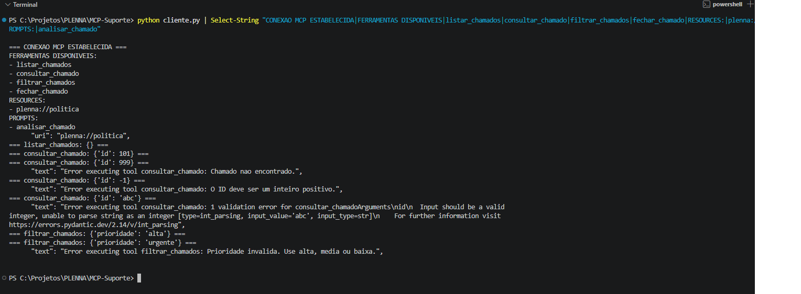

### Consultas e validações

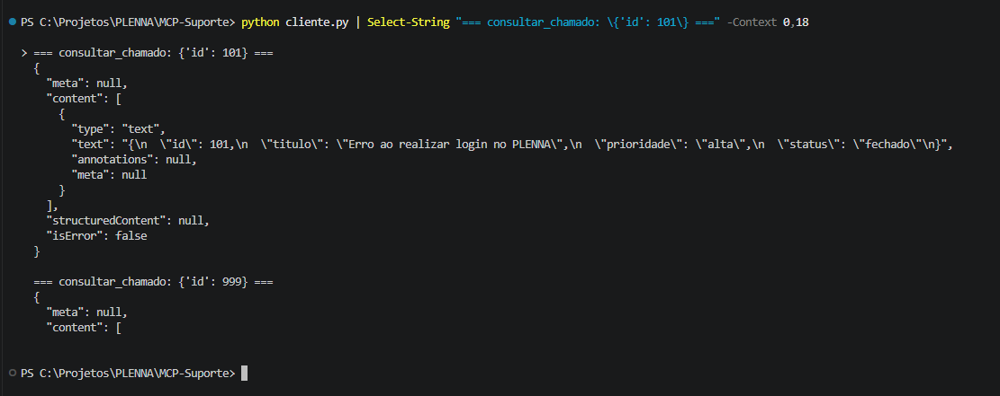

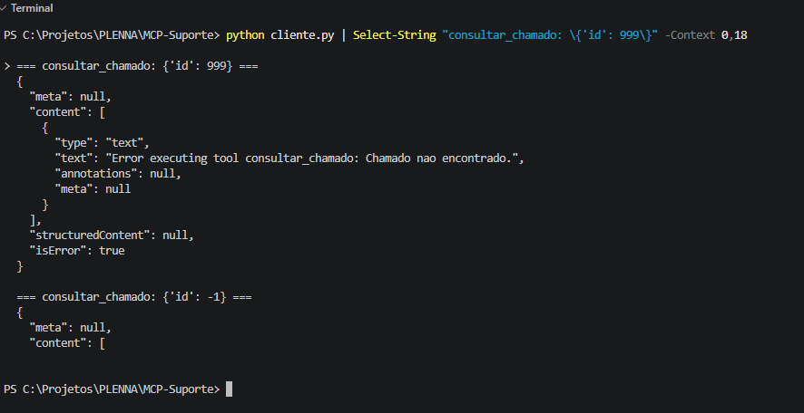

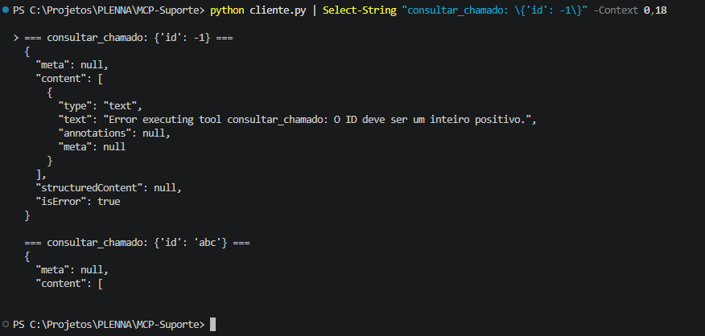

### Filtragem e validação da prioridade

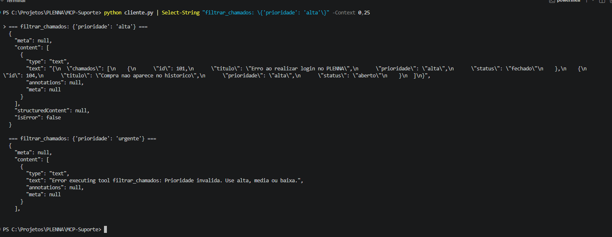

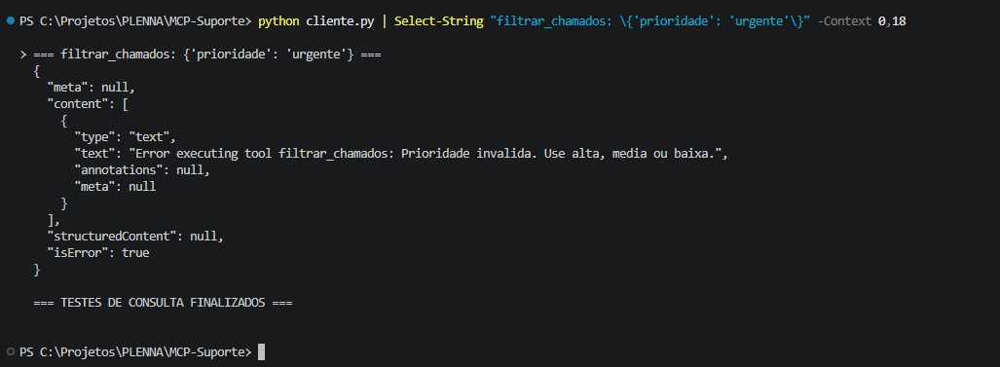

### Confirmação, escrita e persistência

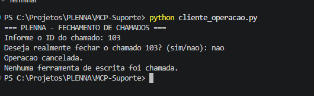

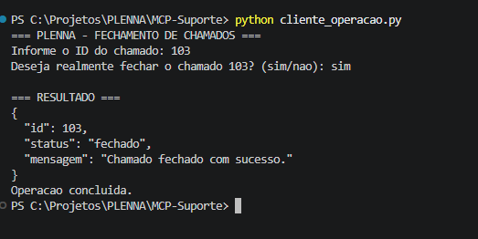

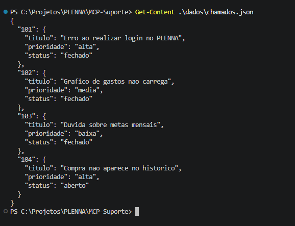

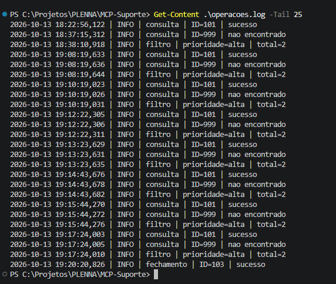

O log registra `fechamento | ID=103 | sucesso` em 13/10/2026 às 19:20:28. O cancelamento ocorre no cliente, antes de chamar a ferramenta de escrita, por isso não deve produzir um registro de fechamento no servidor.

## Evidências visuais dos testes

As capturas abaixo foram registradas durante a execução real da atividade, em 13/10/2026. Elas permitem conferir a ferramenta selecionada pelo modelo e comparar a resposta exibida com os registros de `operacoes.log`.

**Figura 1 — Solicitação de ferramenta e parâmetros antes da autorização.** O LM Studio apresenta `consultar_chamado` do servidor `mcp/plenna-suporte` com o argumento `{"id":101}`. Essa tela mostra a intenção de chamada, ainda pendente de autorização.

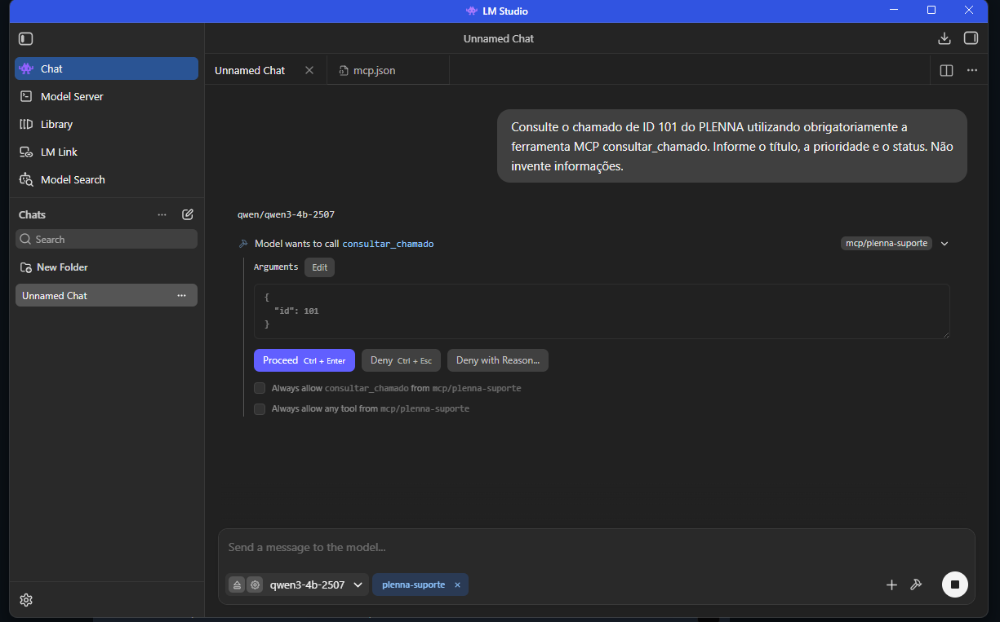

**Figura 2 — Consulta do chamado 101 concluída.** Após autorizar a execução, o Qwen apresenta título, prioridade e status obtidos pela ferramenta.

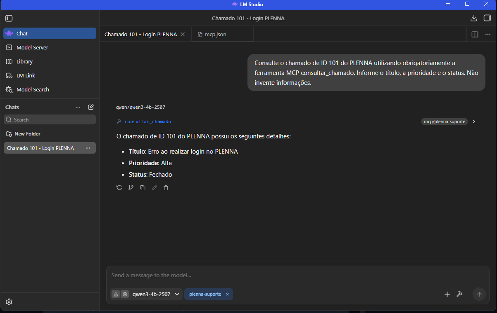

**Figura 3 — Tratamento de chamado inexistente.** A chamada `consultar_chamado` para o ID 999 retorna a ausência do registro, sem informações inventadas.

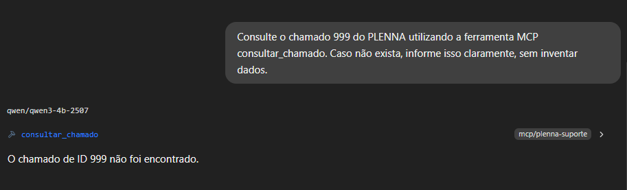

**Figura 4 — Filtragem de chamados de prioridade alta.** A ferramenta `filtrar_chamados` apresenta os registros 101 e 104, com os respectivos estados.

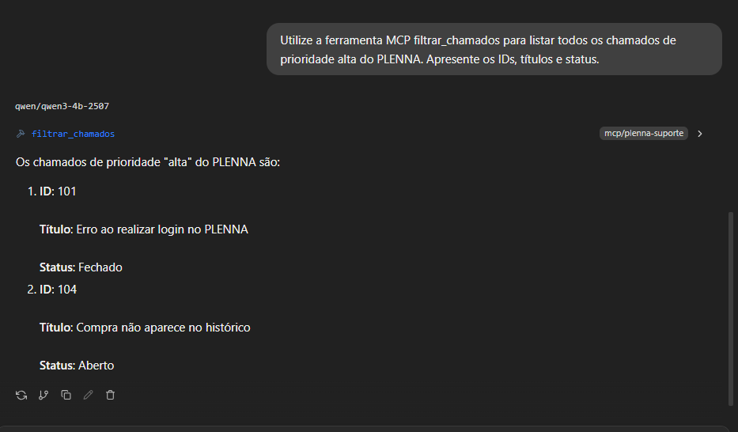

**Conferência adicional pelo terminal:** execute `Get-Content .\operacoes.log -Tail 15` para verificar as operações efetivamente executadas. As imagens demonstram a interação no host; o log confirma a execução no servidor. O fechamento do chamado 102 foi comprovado no cliente Python e no log, não na interface de IA.

## Segurança, escolhas e limitações

As restrições foram pensadas para um exercício de laboratório, e não para um ambiente de produção:

- **Escopo dos dados:** o servidor usa apenas o arquivo local `dados/chamados.json`; não acessa a API, o banco de dados ou dados reais de usuários do PLENNA.
- **Validação:** IDs inválidos e prioridades fora do conjunto aceito são rejeitados; chamados inexistentes não são inventados.
- **Confirmação de escrita:** `cliente_operacao.py` exige confirmação antes de chamar `fechar_chamado`. **Essa confirmação está no cliente**, não é imposta pela ferramenta do servidor. Um host diferente pode invocar a Tool diretamente se tiver permissão; por isso, não se deve habilitar autorização automática indiscriminadamente.
- **Rastreabilidade:** consultas, filtros e fechamentos relevantes geram registros em `operacoes.log`. O log demonstra operações executadas, mas não é uma auditoria imutável.
- **Persistência:** o JSON permite visualizar as alterações entre execuções, mas não possui controle de concorrência, transações, autenticação, perfis de acesso ou proteção contra edição externa.
- **Transporte:** o MCP usa `stdio`; mensagens de protocolo trafegam pela saída padrão do processo. O servidor não deve usar `print` para mensagens de depuração nesse canal.

Uma evolução natural seria mover as regras de autorização de escrita para uma camada de segurança independente do cliente, além de adotar armazenamento transacional e testes automatizados. Essas melhorias **não fazem parte da implementação entregue**.

## O que aprendemos com a demonstração

O teste mais importante não foi o modelo acertar que o chamado 101 estava fechado. Foi conseguir verificar **de onde veio essa informação**: o Qwen solicitou `consultar_chamado`, o host encaminhou a chamada ao servidor MCP, o Python consultou o JSON, o log registrou a operação e só então a IA apresentou a resposta.

O projeto mostra, em escala reduzida, como um assistente pode ser conectado a dados e ações delimitados. Também evidencia um limite essencial: disponibilizar uma ferramenta para a IA não elimina a necessidade de validar entradas, restringir permissões e exigir confirmação antes de modificar dados.

---

**Contexto:** atividade prática avaliativa de MCP — ADS, 6º semestre. Projeto demonstrativo inspirado no PLENNA, sem integração com os sistemas reais do aplicativo.

### Evidência complementar — Integração habilitada no LM Studio

A captura abaixo apresenta a configuração da integração do servidor MCP com o LM Studio, utilizada para disponibilizar as ferramentas à aplicação de IA.

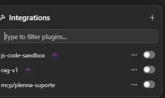


## Documentação acadêmica

O relatório apresenta a implementação do servidor MCP, os testes realizados e a integração com o LM Studio.

- [Relatório acadêmico em PDF](docs/Relatorio_MCP_PLENNA_Marina_Sandy.pdf)
- [Relatório acadêmico em Word](docs/Relatorio_MCP_PLENNA_Marina_Sandy.docx)

As 15 capturas de tela dos testes e da integração com a IA estão disponíveis na pasta `evidencias/` e documentadas neste README.
